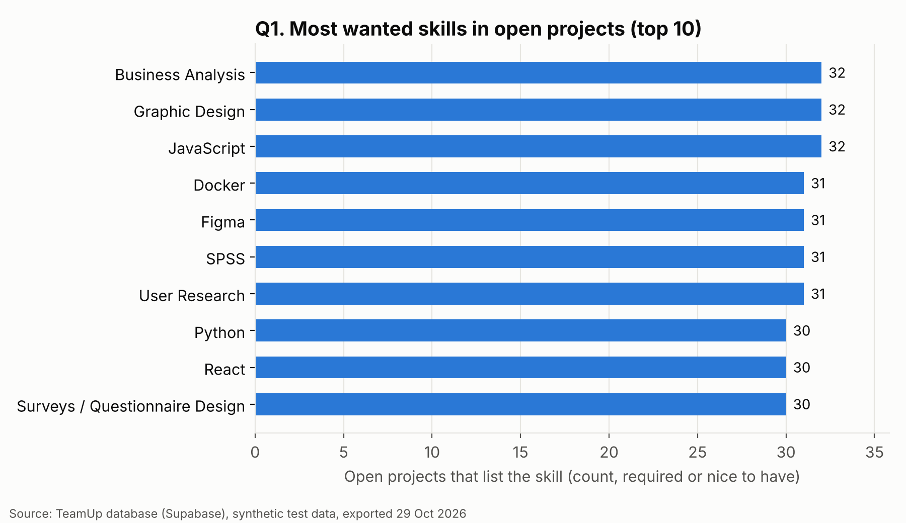
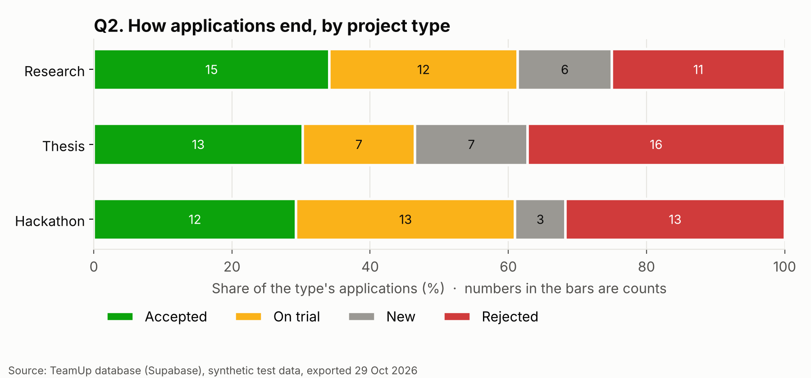
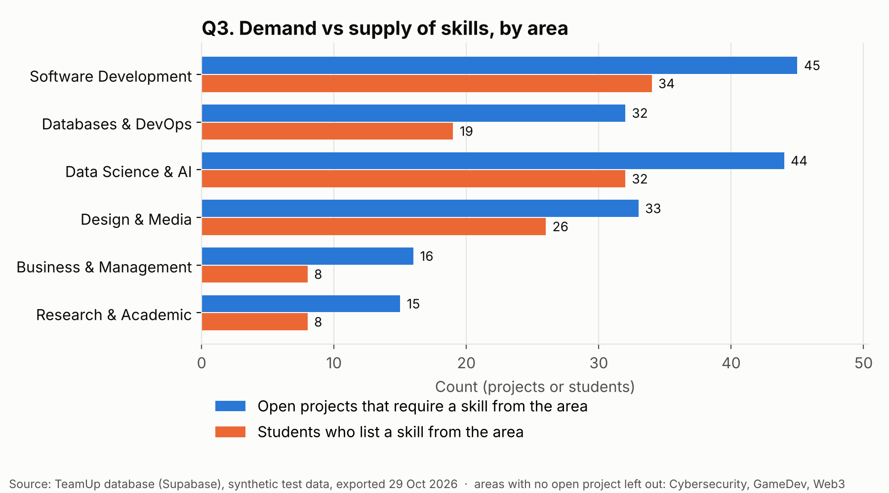

# Data analysis (End-term, Part C)

Three questions about what the TeamUp database knows, with the SQL that answers each one, the
results, the charts and what they mean. Everything here can be repeated by another student.

> **The data is synthetic test data** generated for the prototype (102 projects, 128 applications,
> 43 profiles, exported on 29 Oct 2026). The charts show that the method works; they do not show
> what real students do.

## C1. Questions

| # | Question | Who wants the answer |
|---|---|---|
| Q1 | Which skills do open projects need most? | Students choosing what to learn or list in their profile; shown on the Find page |
| Q2 | How do applications end, by project type? | An administrator checking whether some project types leave candidates waiting or rejected |
| Q3 | In which skill areas do projects need more people than students offer? | An administrator deciding where to invite new students to the platform |

## C2. Method

1. Open **Supabase → SQL Editor → New query**.
2. Paste one of the files below and press **Run**:
   - [`q1_most_wanted_skills.sql`](q1_most_wanted_skills.sql) — `GROUP BY` skill, `COUNT(*)` with `FILTER` for required and nice to have, only open projects.
   - [`q2_outcomes_by_type.sql`](q2_outcomes_by_type.sql) — `GROUP BY` project type, a `COUNT(*) FILTER` per status, and the accepted share among applications that already got a decision (`accepted / (accepted + rejected)`).
   - [`q3_demand_vs_supply.sql`](q3_demand_vs_supply.sql) — two `GROUP BY` subqueries per skill category: open projects that *require* a skill from it (`COUNT(DISTINCT project_id)`) and students who list one (`COUNT(DISTINCT user_id)`), joined on the category.
3. Download the result (**Export → CSV**) over the matching `qN_*.csv` file.
4. Run `python3 charts.py` (needs `pip install matplotlib`). The charts are written to [`charts/`](charts/).

Results on 29 Oct 2026: [`q1_most_wanted_skills.csv`](q1_most_wanted_skills.csv), [`q2_outcomes_by_type.csv`](q2_outcomes_by_type.csv), [`q3_demand_vs_supply.csv`](q3_demand_vs_supply.csv).

## C3. Charts

**Q1 — bar chart** (comparing categories; horizontal so long skill names stay readable).
Top: Business Analysis, Graphic Design and JavaScript, 32 open projects each; then Docker, Figma, SPSS and User Research, 31.

**Q2 — 100 % stacked bar chart** (the parts of a whole for each type; counts written in the bars).

| Type | Applications | New | On trial | Accepted | Rejected | Accepted of decided |
|---|---|---|---|---|---|---|
| Research | 44 | 6 | 12 | 15 | 11 | 57.7 % |
| Thesis | 43 | 7 | 7 | 13 | 16 | 44.8 % |
| Hackathon | 41 | 3 | 13 | 12 | 13 | 48.0 % |

**Q3 — grouped bar chart** (two counts side by side for each area, one axis, same unit).

| Area | Open projects that require it | Students who list it | Students per project |
|---|---|---|---|
| Software Development | 45 | 34 | 0.76 |
| Databases & DevOps | 32 | 19 | 0.59 |
| Data Science & AI | 44 | 32 | 0.73 |
| Design & Media | 33 | 26 | 0.79 |
| Business & Management | 16 | 8 | 0.50 |
| Research & Academic | 15 | 8 | 0.53 |

Why these chart types: all three compare categories (skills, project types, areas), so they are bar
charts; nothing here changes over time, so a line chart would suggest a trend that is not there. Q2
also has a table because the exact percentages matter.

## C4. Interpretation (draft, ~180 words)

In the test data, demand for skills is spread almost evenly: the ten most wanted skills are each
listed by 30–32 of the 92 open projects, so no single skill dominates (Q1). Research projects
convert applications best: 57.7 % of decided applications were accepted, against 48.0 % for
hackathons and 44.8 % for theses, and theses have the most rejections (16) (Q2). In every skill
area, open projects outnumber the students who offer that skill; the gap is widest in Business &
Management (0.50 students per project), Research & Academic (0.53) and Databases & DevOps (0.59) (Q3).

**Decision:** an administrator could invite students from the programmes that teach these areas
(for example IT Management and Big Data Analysis) and show thesis authors a reminder to answer or
try candidates before rejecting them.

**Limitations:** the data is synthetic, so these numbers show that the method works, not how real
students behave. It is one snapshot of a small database; a student counts once per area whatever
their level, and projects count once whatever the number of people they need.

## C5. Data in the product

Q1 runs inside the prototype: the **Most wanted skills** card on the Find page shows the top five
skills and their counts, read from the `skill_demand` view (migration 9), which is the same
`GROUP BY` as Q1. Clicking a skill filters the projects by it. On the defense, the number on the
card can be compared with the result of `q1_most_wanted_skills.sql`.
