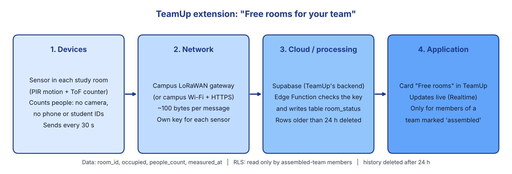

# IoT and smart systems (End-term, Part D)

D1 is a real IoT system used by universities. D2 is how TeamUp could be extended with one. D3 (a
simulation) is optional and not done.

## D1. Real case: live study-room occupancy in university libraries

Several US universities, among them Cal Poly, UC Santa Barbara, UW–Madison and Vanderbilt, show
students how busy each library floor or study room is before they walk over, using Occuspace
sensors and its Waitz app [1][2][3][5].

- **Devices:** small sensors plugged in around each area. They pick up the Bluetooth and Wi-Fi
  signals that phones and laptops send out and estimate how many people are there.
- **Connectivity:** each sensor sends its estimate over the building's network to Occuspace's cloud.
- **Data:** an anonymous count per area, shown as a share of the area's capacity. Vanderbilt
  states that no personally identifiable information is collected [3].
- **Processing:** in the cloud. Counts are turned into busy levels and shown in near real time in
  the app and on library web pages.
- **Benefit:** students save time and spread out to quieter floors; libraries see which spaces are
  actually used and when.
- **Risk:** accuracy. Counting signals is an estimate, and UC San Diego found it could not show
  whether a specific computer was free [4]. Privacy is a second concern, because the sensors
  listen to signals from personal devices.

*(about 180 words)*

## D2. Smart extension: "Free rooms for your team"

**Problem it solves.** TeamUp ends when a team is assembled (the author marks the project
**Team assembled**). The next thing the team needs is a place to meet, and today they walk from
room to room looking for an empty one. The extension shows the team which AITU study rooms are free
right now, inside TeamUp.



*(Diagram source: [`diagram.py`](diagram.py), `python3 diagram.py`.)*

### The four layers

| Layer | What | Details |
|---|---|---|
| 1. Devices | One occupancy sensor per study room | A PIR motion sensor plus a time-of-flight (ToF) people counter at the door. It counts people; it has no camera and does not see phones or student IDs. |
| 2. Network | Campus LoRaWAN gateway, or campus Wi-Fi | LoRaWAN fits battery sensors and encrypts each message with AES-128 keys. On Wi-Fi the sensor sends HTTPS. Each sensor has its own key. |
| 3. Cloud / processing | Supabase, which TeamUp already uses | A Supabase Edge Function receives a reading, checks the sensor's key and writes a row to a new table `room_status`. A scheduled job deletes rows older than 24 h. |
| 4. Application | A **Free rooms** card in TeamUp | Shown to members of an assembled team. It updates without reloading through Supabase Realtime, the same way the notification bell does now. |

A similar setup already works in research: the University of Oulu ran people counters over LoRaWAN
across its campus and reports about 95 % accuracy for its counting model, but also lost packets in
the large deployment [6]. So the card must show when a reading is old (for example "no data for
5 min") instead of claiming a room is free.

### Where it connects to the current database

Design only, not applied to the database. If it is built, it becomes a new numbered migration and
`schema.sql` is updated, as for every other change.

```sql
create table public.rooms (
  id        text primary key,          -- e.g. 'C1.3.247'
  building  text not null,
  capacity  int  not null
);

create table public.room_status (
  room_id      text not null references public.rooms(id),
  occupied     boolean not null,
  people_count smallint not null,
  measured_at  timestamptz not null default now(),
  primary key (room_id, measured_at)
);

-- who may read: members of an assembled team (its author or an accepted candidate)
create policy "room status for assembled teams" on public.room_status
  for select to authenticated using (exists (
    select 1 from public.projects p
    where p.status = 'assembled'
      and (p.author_id = auth.uid()
        or exists (select 1 from public.applications a
                   where a.project_id = p.id and a.candidate_id = auth.uid() and a.status = 'accepted'))));
-- no insert/update policy for users: only the Edge Function (service role) writes readings
```

It reuses what exists: `projects.status = 'assembled'` and accepted `applications` decide who is in
a team, RLS decides who can read, and Realtime pushes changes to the page.

### Data: what, how often, how much

- **What:** `room_id`, `occupied`, `people_count`, `measured_at`. Nothing about who is in the room.
- **How often:** every 30 s, about 2 880 readings per room per day.
- **How much:** about 100 bytes per message. For 30 study rooms: about 86 000 rows and 9 MB of
  traffic per day. Because rows older than 24 h are deleted, the table stays around that size,
  far below the free plan's 500 MB database limit.

### Security and privacy

| Risk | Protection |
|---|---|
| Fake readings (someone sends "room empty" or floods the server) | Each sensor has its own key, checked by the Edge Function; users have no insert rights on `room_status`; readings from unknown sensors or more than one per 10 s are dropped. |
| Location data: a team's members can see who is in a room, and a count of 1 late at night can point to one person | The card shows only a level (*free / some people / full*), not the exact count. Only members of assembled teams can read it, enforced by RLS like the Telegram contacts. |
| History reveals habits (when a room or a group is usually there) | Only 24 h of readings are kept; no link between a reading and a user is stored. |
| Someone tampers with a sensor physically | Sensors are mounted at the ceiling; a sensor that stops reporting is shown as "no data", not "free". |
| Readings are wrong (D1 shows this happens) | The card says how old the reading is and is a hint, not a booking. |

These follow the same rules as the privacy analysis in Assignment 3: collect the minimum, show it
only to people who need it, and delete it when it is no longer useful.

## Sources

1. Cal Poly, *Real-time occupancy of available study spaces*: https://mate.calpoly.edu/real-time-occupancy-available-study-spaces
2. Daily Nexus (UCSB), *The best time to hit the books: occupancy trends in the UCSB Library*, 3 Nov 2023: https://dailynexus.com/2023-11-03/the-best-time-to-hit-the-books-exploring-occupancy-trends-in-the-ucsb-library/
3. Vanderbilt University, *Campus Dining, libraries launch new capacity monitoring system*, 8 Sep 2022: https://news.vanderbilt.edu/2022/09/08/campus-dining-libraries-launch-new-capacity-monitoring-system-to-improve-student-experience
4. UC Tech News, *UCSD Library finds innovation through imperfect iteration*: https://uctechnews.ucop.edu/its-finals-and-i-need-a-computer-ucsd-library-finds-innovation-through-imperfect-iteration/
5. UW–Madison IT: https://it.wisc.edu/?p=470722
6. University of Oulu, LoRaWAN smart campus dataset (arXiv 2304.13366): https://arxiv.org/pdf/2304.13366
